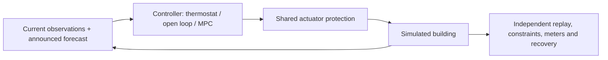

# HVAC Control Benchmark

A reproducible single-zone simulation comparing a thermostat, a frozen day-ahead schedule and model predictive control (MPC).

**Minimize energy cost, subject to hard temperature, CO2 and equipment constraints.** The objective contains only gas and electricity cost. There are no comfort slacks or penalty weights.



Open loop plans once; MPC replans every 15 minutes and applies its first action. Both optimize the same physical model. Weather, occupancy and heat-loss mismatches test what happens when the forecast or model is wrong. A failed optimization is reported with its cause; an emergency rule may continue the simulation without a feasibility claim.

## Reproduce

Python 3.11 is the reference environment.

```bash
python -m pip install -r requirements.txt
python -m pip install --no-deps -e .
python -m pytest -q
hvac-benchmark --suite smoke --output results/smoke
hvac-benchmark sensitivity --stage all --output results/corrected-study
```

The smoke suite has 12 runs. The corrected study has 34 runs and a predeclared requested solver-budget sum of 1353 seconds plus overhead. Outputs must use an empty directory. [GitHub Actions](https://github.com/SaeedAkbare/HVAC-Control-Benchmark/actions) runs regression checks, smoke tests and the bounded corrected study.

## Evidence and interpretation

Corrected execution and figures are pending this source revision's first Actions run. The previous [reference](reports/reference-2026-11-10/README.md) and [sensitivity archive](reports/sensitivity-2026-11-11/README.md) used a soft-constraint formulation and are explicitly superseded.

Compare costs only alongside continuous temperature/CO2 excursions, predictive feasibility, fallback steps, actuator overrides and terminal recovery. Cost includes a common 16-hour continuation; operation and recovery are also reported separately. A lower bill with invalid service is not an equivalent-service saving.

## Scope and method

- [Physical model, hard MILP formulation and constraint interpretation](docs/method.md)
- [Fixed study protocol and computational bounds](docs/sensitivity.md)
- [Synthetic data and causal forecasts](docs/data.md)
- [Validation record](docs/validation.md)
- [Attribution and AI assistance](ACKNOWLEDGMENTS.md)

Weather, occupancy and prices are **physically plausible synthetic surrogates**, not measurements. This is a low-order educational simulation: perfect current observations, no humidity, solar gains, equipment delay or multizone effects. It provides no field savings, deployment, robustness or universal controller-ranking claim.
