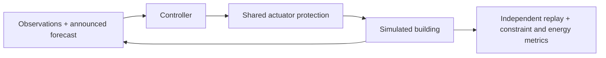
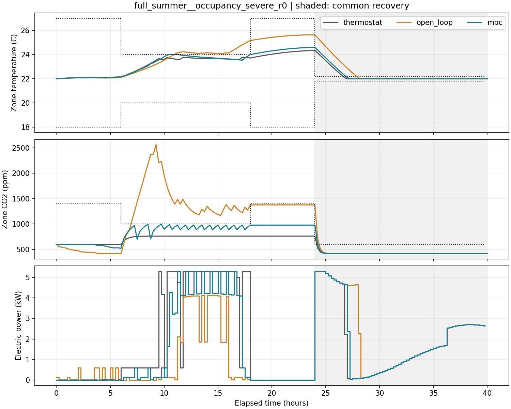

# HVAC Control Benchmark

A reproducible single-zone simulation comparing a thermostat, a frozen day-ahead schedule and model predictive control (MPC).

**Problem:** minimize electricity and gas cost subject to **hard temperature, CO2 and equipment constraints**. The optimizer has no comfort slacks or penalty weights. Weather, occupancy and prices are explicitly synthetic.



Open loop optimizes once; MPC replans every 15 minutes and applies its first action. The finite-mode MILP uses exact exponential dynamics and hard comfort at both interval endpoints. Forecast feasibility is distinct from realized service under uncertainty. Infeasibility, timeouts and emergency rule operation are reported separately.

## Quick start

From the repository root, using Python 3.11:

```bash
python -m pip install -r requirements.txt
python -m pip install --no-deps -e .
python -m pytest -q
hvac-benchmark --suite smoke --output results/smoke
```

The smoke command runs 12 controller experiments and writes metrics, traces and plots. Output directories must be empty.

To reproduce the fixed 34-run study:

```bash
hvac-benchmark sensitivity --stage all --output results/corrected-study
```

The recorded study took about 12 minutes; solver time limits can produce different incumbents on another machine. [CI](.github/workflows/ci.yml) runs tests, package checks and both smoke entry points. Longer studies are manual workflow choices.

## Selected executed results

The [corrected study](reports/corrected-2026-11-15/README.md) contains 34 runs with independent ODE replay, equipment audits and common terminal recovery. The table shows **total EUR / valid operating service**, including 24 operating hours and the same 16-hour recovery.

| Scenario | Thermostat | Open loop | MPC |
|---|---:|---:|---:|
| Summer nominal | 9.09 / pass | 8.38 / pass | 8.21 / pass |
| Summer early/high occupancy | 13.33 / pass | 9.09 / fail | 11.05 / pass |
| Winter heat-loss mismatch | 23.28 / fail | 22.08 / fail | 23.34 / fail |

A low bill with failed service is not an equivalent-service saving. The ten-second nominal day-ahead plans were hard-feasible but retained 42.68% winter and 26.78% summer optimality gaps. MPC used a six-hour horizon and roughly 87–111 seconds of total solve/build time per day; open loop used one 24-hour solve of about ten seconds. Different horizons, computation and unresolved gaps limit the comparison.



*Early/high occupancy broke the frozen plan's realized service. MPC and the thermostat met the operating limits in this case; the shaded region is common recovery. Heat-loss mismatch exposed failures elsewhere.*

[All scenarios and limitations](reports/corrected-2026-11-15/README.md) · [Nominal winter plot](reports/corrected-2026-11-15/figures/full_winter__nominal_r0.png) · [Budget plot](reports/corrected-2026-11-15/figures/solver_budget.png) · [Metrics](reports/corrected-2026-11-15/metrics.csv) · [Optimization attempts](reports/corrected-2026-11-15/solves.csv)

## Repository guide

| Location | Contents |
|---|---|
| [Source](src/hvac_benchmark/) | Physics, causal scenarios, three controllers, evaluation and CLI |
| [Tests](tests/) | Dynamics, constraints, optimization equivalence, failure handling and CLI checks |
| [Method](docs/method.md) | Equations, hard MILP formulation and comparison protocol |
| [Data](docs/data.md) | Synthetic inputs, seeds and information policy |
| [Study protocol](docs/sensitivity.md) | Fixed cases, solver budgets and resource limits |
| [Validation](docs/validation.md) | Executed checks and exact tested revisions |
| [Reports](reports/) | Current evidence and clearly marked superseded archives |

## Scope and license

This is an AI-assisted educational simulation, with [attribution](ACKNOWLEDGMENTS.md) and an [MIT license](LICENSE). It uses a low-order plant, perfect current observations and known prices. Humidity, solar gains, equipment delays and multizone effects are omitted. One synthetic repeat provides no field-savings, deployment or general robustness claim.

Earlier soft-constraint reports are preserved as superseded evidence; current claims use the corrected hard-constraint results. [Transfer notes](docs/transfer.md) list the remaining account-specific checks. [Privacy status](docs/privacy.md) distinguishes current-file cleanup from the pending history cleanup.
