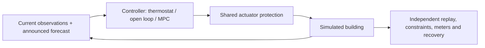

# HVAC Control Benchmark

A reproducible single-zone simulation comparing a thermostat, a frozen day-ahead schedule and model predictive control (MPC).

**Minimize energy cost subject to hard temperature, CO2 and equipment constraints.** The objective contains only gas and electricity cost. There are no comfort slacks or penalty weights.

[](https://github.com/SaeedAkbare/HVAC-Control-Benchmark/actions/workflows/ci.yml)



Open loop plans once. MPC replans every 15 minutes and applies its first action. The finite-mode MILP uses exact exponential dynamics and hard comfort at both interval endpoints. Forecast-feasible plans can still violate realized limits under weather, occupancy or model errors. Failed solves retain their cause; emergency rule operation carries no optimization-feasibility claim.

## Verified results

[The corrected report](reports/corrected-2026-11-15/README.md) records **46 passing tests, 15 smoke runs and 34 study runs**. All study runs passed independent physical audits and terminal recovery. Several failed operating comfort; those failures are retained.

Each cell below is **total EUR / valid service**. Cost includes 24 operating hours plus the same 16-hour recovery. Service requires zero operating excursions beyond the unchanged numerical tolerance and successful terminal restoration.

| Full-day case | Thermostat | Open loop | MPC |
|---|---:|---:|---:|
| Winter nominal | 16.35 / fail | 16.81 / pass | 15.62 / pass |
| Winter weather error | 19.08 / fail | 18.65 / fail | 18.09 / pass |
| Winter heat-loss mismatch | 23.28 / fail | 22.08 / fail | 23.34 / fail |
| Summer nominal | 9.09 / pass | 8.38 / pass | 8.21 / pass |
| Summer early/high occupancy | 13.33 / pass | 9.09 / fail | 11.05 / pass |
| Summer heat-loss mismatch | 11.23 / pass | 9.93 / fail | 10.31 / fail |

The 10-second nominal day-ahead solves returned hard-feasible plans, with remaining gaps of 42.68% in winter and 26.78% in summer. At 0.5 and 2 seconds, no incumbent was found. The lower-cost failed-service rows are not equivalent-service savings.

MPC uses a six-hour horizon and about 87–111 seconds of total solve/build time per full day; open loop uses one 24-hour solve of about 10 seconds. These differences and unresolved gaps prevent a universal economic ranking. The report also includes matched four-hour feedback diagnostics and all failure causes.


*Both nominal optimized trajectories met operating limits. The thermostat's small occupied-period temperature deficit is counted as a failure.*


*Unexpected early/high occupancy broke the frozen plan's realized service. MPC and the thermostat met the limits here; heat-loss mismatch exposed failures in other cases.*

[Budget figure](reports/corrected-2026-11-15/figures/solver_budget.png) · [All metrics](reports/corrected-2026-11-15/metrics.csv) · [Every optimization attempt](reports/corrected-2026-11-15/solves.csv) · [Successful CI run](https://github.com/SaeedAkbare/HVAC-Control-Benchmark/actions/runs/43710709106)

## Reproduce

Python 3.11 is the reference environment.

```bash
python -m pip install -r requirements.txt
python -m pip install --no-deps -e .
python -m pytest -q
hvac-benchmark --suite smoke --output results/smoke
hvac-benchmark sensitivity --stage all --output results/corrected-study
```

The smoke suite has 12 runs. The bounded study has 34 runs and a predeclared requested solver-budget sum of 1353 seconds plus overhead; the recorded run took about 12 minutes. Use empty output directories. Exact source revisions, settings, input hashes, seeds, package versions and artifact digests are archived. Time-limited solver outcomes can vary across machines and repeats.

## Scope and provenance

Weather, occupancy and prices are **physically plausible synthetic surrogates**, not measurements. This AI-assisted educational project uses a low-order plant with perfect current observations and known prices. Humidity, solar gains, equipment delay and multizone effects are omitted. One repeat provides no field-savings, deployment, robustness or statistical-generalization claim.

The earlier [reference](reports/reference-2026-11-10/README.md) and [sensitivity](reports/sensitivity-2026-11-11/README.md) archives used an incorrect soft-constraint formulation. They are preserved as superseded evidence; current claims use only the corrected results.

[Method](docs/method.md) · [Fixed study protocol](docs/sensitivity.md) · [Data and causal forecasts](docs/data.md) · [Validation](docs/validation.md) · [Attribution and AI assistance](ACKNOWLEDGMENTS.md)
