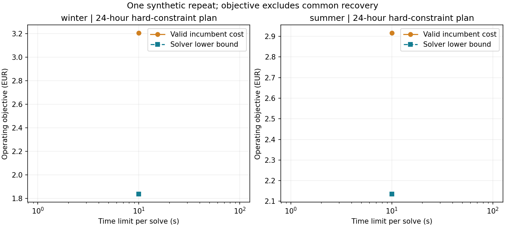
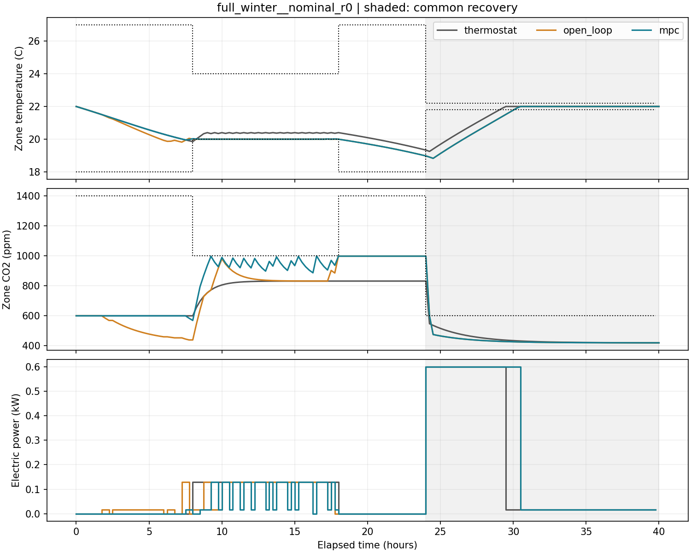
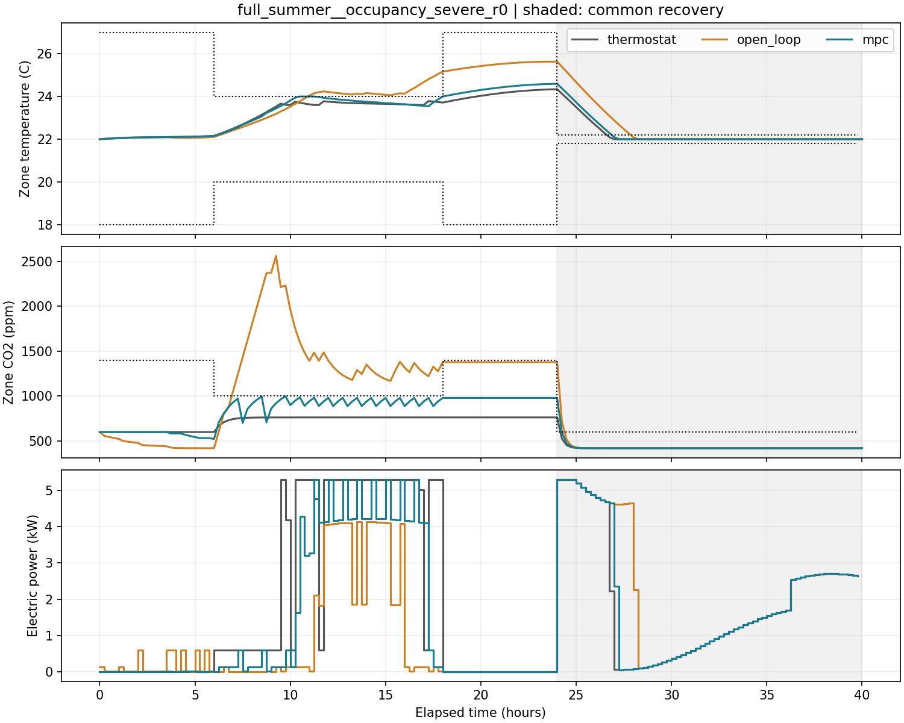

# Corrected hard-constraint results — 15 November 2026

The corrected benchmark minimizes **energy cost subject to hard temperature, CO2 and equipment constraints**. There are no comfort slacks or penalty costs. The previous soft-constraint formulation did not represent that problem; its [reference](../reference-2026-11-10/README.md) and [sensitivity](../sensitivity-2026-11-11/README.md) archives are preserved and marked superseded.

This initial corrected study completed successfully, including cases where optimization or realized service failed. **Completion is not a claim that every controller met the hard limits.**

## Verified execution

- Tested source: [1150f15](https://github.com/SaeedAkbare/HVAC-Control-Benchmark/commit/1150f15ee7211b57f0d24907268616854276c8a2).
- [Successful Actions run 43710709106](https://github.com/SaeedAkbare/HVAC-Control-Benchmark/actions/runs/43710709106), executed 15 November 2026.
- **46 regression tests passed** in 1.76 seconds, with 14 upstream Matplotlib/Pyparsing deprecation warnings.
- **12 benchmark smoke runs and three corrected-study smoke runs completed.**
- **34 corrected study runs completed:** 18 full-day comparisons, four additional budget cases and 12 matched-window cases.
- All 34 passed independent ODE replay and equipment audits, and reached the unchanged common terminal target. Maximum replay discrepancies were 8.171e-14 C and 3.620e-8 ppm. No actuator overrides occurred.
- Actual study wall time: **715.652 seconds**; summed solve/build/fallback time: **710.229 seconds**. The declared solver-budget upper bound was 1353 seconds.
- Python 3.11.18, NumPy 2.2.6, SciPy 1.15.3, Matplotlib 3.10.3, pytest 8.3.5.
- The optional 84-run full seasonal matrix was not rerun in this corrected study.

The tests include an independent two-step exhaustive enumeration of all mode and heating/cooling sign sequences, compared with the new MILP for cold and hot cases. They also check exact energy-only objectives, hard bounds at occupancy transitions, infeasibility under insufficient capacity, distinct solver failures, explicit emergency operation, causal forecasts and realized violations despite valid predictions.

## Evidence and fixed protocol

[metrics.csv](metrics.csv) and [metrics.jsonl](metrics.jsonl) preserve all 34 metric rows. [solves.csv](solves.csv) and [solves.jsonl](solves.jsonl) preserve all 654 call records, including failures. JSONL files retain exact job-log payloads; CSV files reconstruct the same values with ordinary CSV escaping.

[protocol.json](protocol.json), [manifest.json](manifest.json) and [provenance.json](provenance.json) record the exact source, settings, versions, input definitions and artifact digest. Every row carries protocol ID `a84bbef31c2d4ff5e8e1b61f52494642a7cb9fe14f74a6d6221bf6c1c530d0ef`. The protocol was emitted before the first metric; all paired controllers and nominal budget runs share the same input hashes. No outcome changed the settings or inputs.

The [complete artifact](https://github.com/SaeedAkbare/HVAC-Control-Benchmark/actions/runs/43710709106/artifacts/14160459146) also contains all executed trajectories and remaining plots. Its recorded expiration is 13 February 2027. The metrics, per-call records, settings and three selected PNG/SVG figures are permanently checked into this archive.

## What the constraints and gates mean

The operating bands are unchanged: 20–24 C and CO2 ≤1000 ppm when occupied, 18–27 C and CO2 ≤1400 ppm when empty. Hard prediction constraints hold at both ends of each interval, including the fixed initial state. Monotone exact held-input dynamics then cover the interior. Bounds from adjoining occupancy intervals are intersected at their common boundary.

The finite-mode formulation disaggregates start/end states by the selected binary mode. It uses the exact exponential dynamics directly, without big-M dynamic equalities. Valid comfort bounds constrain the mode components. Heating/cooling exclusivity, capacities, fan-off behavior and supply-temperature limits remain hard.

A valid incumbent must pass algebraic and exact prediction checks, and its objective must equal the recomputed electricity-plus-gas cost. A valid forecast plan is not a robust guarantee against unforeseen inputs or an incorrect plant model.

**Valid service** requires zero realized operating comfort excursions after the unchanged numerical reporting tolerance (1e-5 C, 0.01 ppm) and the common terminal target. There is no engineering allowance of 0.5 C or 100 ppm from the old soft study. **Comparison eligible** additionally excludes fallback operation, actuator overrides and invalid optimization predictions. Solver quality is a separate screen: every optimization call must report a gap ≤1%.

Across the 34 runs, 22 had valid realized service and 20 were comparison eligible. Two short-budget summer fallback runs happened to provide valid service, but are excluded as valid optimized plans. Ten runs passed the stricter quality screen, including thermostat rows where solver quality is not applicable. These counts mix full days and short windows and are not performance rates for a population.

Cost and meter totals include the common 16-hour recovery: 40 hours for full-day cases, 20 for matched windows. Hard operating comfort and recovery are reported separately. Recovery bands in the shaded plot regions are restoration targets, not claims that restoration is instantaneous. Every final state met the existing 22 ±0.05 C / CO2 ≤601 ppm criterion; the largest temperature residual was 0.02564 C. This is equivalence within the declared terminal tolerance, not identical final states.

## Nominal solver-budget findings

Same winter/summer inputs, 24-hour plans, unchanged equipment and hard bounds:

| Period | Budget s | Solve result | Incumbent cost | Lower bound | Relative gap | Fallback steps |
|---|---|---|---|---|---|---|
| summer | 0.5 | time_limit_no_incumbent | — | — | — | 96 |
| summer | 2 | time_limit_no_incumbent | — | — | — | 96 |
| summer | 10 | feasible_limit | 2.9164 | 2.1353 | 0.2678 | 0 |
| winter | 0.5 | time_limit_no_incumbent | — | — | — | 96 |
| winter | 2 | time_limit_no_incumbent | — | — | — | 96 |
| winter | 10 | feasible_limit | 3.2052 | 1.8371 | 0.4268 | 0 |

At 0.5 and 2 seconds, neither nominal day-ahead solve returned an incumbent. These are **timeouts without a feasible solution found**, not proofs of infeasibility. The emergency thermostat rollout was frozen for all 96 operating steps. Its bill is retained in the metrics but is not an optimizer objective.

At 10 seconds, both nominal day-ahead plans were validated and had zero realized operating comfort excursions. Remaining gaps were **42.68% (winter)** and **26.78% (summer)**; neither was certified within the requested 1% tolerance. Objective and lower bound are operating energy cost, excluding recovery.

Only the 10-second points have available objectives/bounds. The shorter-budget results are missing points because no incumbent or bound was reported; the table carries their failure statuses.

This resolves the model-fidelity error, not all search difficulty. The former roughly 99.9% gaps belonged to a different soft problem, so they are not a controlled before/after speed benchmark for the disaggregation alone. Repeated runs and further equivalent formulation/search work remain possible; no additional budget or physical limit was silently changed.

## Full-day comparisons

Open loop has a 10-second full-day solve. MPC uses a six-hour horizon and two seconds per call, with 96 calls per day. The thermostat uses current observations. Each row includes the same recovery protocol.

Temperature/CO2 columns show **peak excess beyond the bound / duration outside it**, not absolute room readings. Gaps are fractions: 0.4268 means 42.68%. Full precision, areas, separate electricity/gas and all status counts are in the CSV.

| Scenario | Method | Total EUR | T peak C / hours | CO2 peak ppm / hours | Fallback steps | Eligible | Max gap |
|---|---|---|---|---|---|---|---|
| winter__nominal | thermostat | 16.3468 | 0.1471 / 0.2308 | 0.00 / 0.0000 | 0 | no | — |
| winter__nominal | open_loop | 16.8055 | 0.0000 / 0.0000 | 0.00 / 0.0000 | 0 | yes | 0.4268 |
| winter__nominal | mpc | 15.6237 | 0.0000 / 0.0000 | 0.00 / 0.0000 | 0 | yes | 0.9245 |
| winter__weather_severe | thermostat | 19.0781 | 0.1471 / 0.2308 | 0.00 / 0.0000 | 0 | no | — |
| winter__weather_severe | open_loop | 18.6494 | 1.4463 / 11.5235 | 0.00 / 0.0000 | 0 | no | 0.4268 |
| winter__weather_severe | mpc | 18.0928 | 0.0000 / 0.0000 | 0.00 / 0.0000 | 0 | yes | 0.9245 |
| winter__loss_severe | thermostat | 23.2816 | 1.2091 / 2.0182 | 0.00 / 0.0000 | 0 | no | — |
| winter__loss_severe | open_loop | 22.0839 | 1.3327 / 12.7261 | 0.00 / 0.0000 | 0 | no | 0.4262 |
| winter__loss_severe | mpc | 23.3384 | 0.4974 / 2.2450 | 0.00 / 0.0000 | 14 | no | 0.8088 |
| summer__nominal | thermostat | 9.0940 | 0.0000 / 0.0000 | 0.00 / 0.0000 | 0 | yes | — |
| summer__nominal | open_loop | 8.3752 | 0.0000 / 0.0000 | 0.00 / 0.0000 | 0 | yes | 0.2678 |
| summer__nominal | mpc | 8.2121 | 0.0000 / 0.0000 | 0.00 / 0.0000 | 0 | yes | 0.4906 |
| summer__occupancy_severe | thermostat | 13.3305 | 0.0000 / 0.0000 | 0.00 / 0.0000 | 0 | yes | — |
| summer__occupancy_severe | open_loop | 9.0870 | 1.1615 / 7.0729 | 1561.40 / 11.0758 | 0 | no | 0.2678 |
| summer__occupancy_severe | mpc | 11.0527 | 0.0000 / 0.0000 | 0.00 / 0.0000 | 0 | yes | 0.3129 |
| summer__loss_severe | thermostat | 11.2299 | 0.0000 / 0.0000 | 0.00 / 0.0000 | 0 | yes | — |
| summer__loss_severe | open_loop | 9.9332 | 0.6723 / 1.3482 | 0.00 / 0.0000 | 0 | no | 0.2678 |
| summer__loss_severe | mpc | 10.3136 | 0.0183 / 0.0502 | 0.00 / 0.0000 | 0 | no | 0.4356 |

Both nominal optimized trajectories met the hard operating limits. The nominal winter thermostat missed the newly occupied temperature band by 0.1471 C for 0.2308 hours; this is reported as invalid service. Its lower bill relative to one open-loop result is therefore not an equivalent-service saving.

In nominal summer, all three methods were eligible. Their observed total costs were EUR 9.0940, 8.3752 and 8.2121 for thermostat, open loop and MPC. These are measurements of this simulation, with unresolved solver gaps and different computational effort; no optimum or universal savings claim follows.

In severe summer occupancy, the frozen plan remained feasible for its original forecast but realized **1561.40 ppm CO2 excess for 11.0758 hours**, plus temperature violations. Its low bill is not a valid-service saving. MPC and the thermostat met all operating comfort limits in that case.

Under winter heat-loss mismatch, **all three controllers failed realized temperature service**. MPC's smaller maximum excursion (0.4974 C) remains a failure. Under summer heat-loss mismatch, MPC's 0.0183 C peak over 0.0502 hours also remains a failure; it is not rounded away or reclassified as acceptable.

No full-day optimizer run passed the every-call 1% quality gate. MPC took approximately 87–111 seconds of solve/build time per day, versus about 10 seconds for the main open-loop plan. Horizon, solve quality and total effort remain confounded.

## Failure diagnosis

The 654 optimization attempts comprise 642 HiGHS invocations and 12 analytic initial-state rejections. The latter do not invoke the solver. The outcomes are:

| Outcome | Calls | Meaning |
|---|---:|---|
| Optimal within requested tolerance | 332 | Validated hard-feasible forecast incumbent |
| Time limit with valid incumbent | 304 | Feasible plan with an unresolved gap |
| Time limit without incumbent | 4 | No valid optimizer plan found; not an infeasibility proof |
| Solver-proven infeasible | 2 | HiGHS status 2 for the current forecast horizon |
| Invalid fixed initial state | 12 | Already outside the current hard interval bounds |
| Numerical/invalid-incumbent failures | 0 | None observed |

The 18 fallback solve events affected **398 operating steps**: four full-day frozen fallbacks (384 steps) plus 14 MPC steps in winter heat-loss mismatch. Fallback is explicitly labelled emergency operation, never hard-constraint relaxation.

For the winter heat-loss MPC case:

| Time h | Reason | Initial state valid | First endpoint reachable |
|---|---|---|---|
| 7.5 | proven_infeasible | yes | yes |
| 7.75 | proven_infeasible | yes | yes |
| 8 | initial_state_infeasible | no | no |
| 8.25 | initial_state_infeasible | no | no |
| 8.5 | initial_state_infeasible | no | no |
| 8.75 | initial_state_infeasible | no | yes |
| 9.5 | initial_state_infeasible | no | yes |
| 9.75 | initial_state_infeasible | no | yes |
| 11.25 | initial_state_infeasible | no | yes |
| 12.5 | initial_state_infeasible | no | yes |
| 13.75 | initial_state_infeasible | no | yes |
| 15 | initial_state_infeasible | no | yes |
| 16.5 | initial_state_infeasible | no | yes |
| 17.75 | initial_state_infeasible | no | yes |

The two solver infeasibility proofs occurred at 07:30 and 07:45 before the scheduled occupied-band change at 08:00. The current state and first endpoint screen still passed then; the full forecast horizon did not. The logged evidence establishes a horizon-level infeasibility, not that the current interval alone was impossible.

At 12 later calls the observed state already violated the current band. No future action can erase that interval-start violation. Three also failed the nominal model's one-step endpoint reachability screen. The rule continued simulation and subsequent MPC calls resumed when feasible. These observations do not prove that every possible whole-day or robust policy would fail this scenario.

## Matched four-hour windows

Both optimization methods initially see the same four-hour horizon and the same fixed end time. Open loop solves once; MPC replans 16 times. Winter windows start at 08:00; summer at 04:00. All temperature excursions in these windows were zero.

| Scenario | Method | Total EUR | CO2 excess ppm h | Valid service | Max gap | Calls | Solve s |
|---|---|---|---|---|---|---|---|
| winter__nominal | thermostat | 9.4492 | 0.0000 | yes | — | 0 | 0.00 |
| winter__nominal | open_loop | 9.1962 | 0.0000 | yes | 0.0818 | 1 | 2.01 |
| winter__nominal | mpc | 9.1954 | 0.0000 | yes | 0.0818 | 16 | 11.89 |
| winter__weather_severe | thermostat | 10.3916 | 0.0000 | yes | — | 0 | 0.00 |
| winter__weather_severe | open_loop | 10.0231 | 0.0000 | yes | 0.0818 | 1 | 2.01 |
| winter__weather_severe | mpc | 10.0223 | 0.0000 | yes | 0.0818 | 16 | 11.17 |
| summer__nominal | thermostat | 5.7815 | 0.0000 | yes | — | 0 | 0.00 |
| summer__nominal | open_loop | 5.7815 | 0.0000 | yes | 0.0000 | 1 | 0.02 |
| summer__nominal | mpc | 5.7815 | 0.0000 | yes | 0.0000 | 16 | 0.14 |
| summer__occupancy_severe | thermostat | 6.9545 | 0.0000 | yes | — | 0 | 0.00 |
| summer__occupancy_severe | open_loop | 6.7202 | 806.6667 | no | 0.0000 | 1 | 0.02 |
| summer__occupancy_severe | mpc | 6.7794 | 0.0000 | yes | 0.0099 | 16 | 0.74 |

Under early/high summer occupancy, the frozen forecast-optimal zero-action schedule incurred 1100 ppm peak CO2 excess over 1.4667 hours (806.6667 ppm h). MPC and the thermostat had no operating CO2 excess. All 16 MPC solves in that disturbed window were within 1% gap (worst 0.009889), using 0.74 seconds in total versus about 0.02 seconds for the single open-loop call.

This is a limited demonstration of responding to newly observed occupancy. The initial lookahead and end time are matched, but total computation and information updates differ. The nominal summer no-action control gave identical cost and comfort for all three. Winter windows passed comfort but did not establish a meaningful weather-feedback advantage.

## Limitations

One repeat, two synthetic seasonal days and selected single disturbances do not establish field savings, robustness, stability or statistical generality. The low-order plant has perfect observations, known prices and no solar gains, humidity, equipment delays or multizone effects. Hard forecast constraints are not robust constraints on unknown future reality.

The synthetic inputs, capacities, thresholds, horizons and terminal goals were retained through the correction. Failures were not repaired by relaxing them or tuning scenarios. Larger repeated studies, measured inputs with appropriate provenance, improved forecasts/model estimation and additional equivalent solver formulations remain unexecuted.
